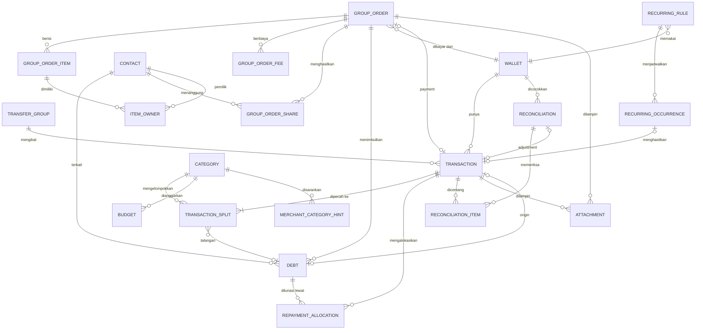

# Arus: ERD & Skema Data (v0.6)

Konsolidasi skema dari v0.4 dengan perubahan v0.6:

- **Utang-piutang dua arah**: tabel `receivable` diganti nama menjadi `debt` dengan kolom `direction`.
- **Tipe transaksi baru**: `LOAN_OUT`, `LOAN_IN`, `DEBT_PAY_OUT`, `NETTING`.
- **Kategori datar**: kolom `parent_id` (subkategori) dihapus dari MVP; kategori sistem baru `DEBT_FORGIVEN`.
- **Piutang lama "catat saja"**: `debt.origin_transaction_id` boleh null.

Dokumen pendamping: `arus-user-flow.md`.

---

## 1. Prinsip Desain

1. **Saldo tidak disimpan, selalu dihitung** dari `initial_balance` + efek transaksi. Mencegah saldo dan riwayat tidak sinkron.
2. **Satu transaksi = satu pergerakan di satu dompet.** Transfer menghasilkan dua baris yang saling terkait lewat `transfer_group`.
3. **Pemisahan efek ke dompet dan efek ke laporan.** Efek dompet ditentukan `type` transaksi; efek laporan ditentukan `transaction_split`. Inilah kunci group order: Rp200.000 keluar dari dompet, tetapi hanya Rp40.000 masuk laporan.
4. **Semua nominal `Long`** (rupiah utuh, tanpa float). Kolom `amount` selalu positif; arah ditentukan `type`.
5. **Waktu** disimpan sebagai epoch millis (UTC) plus `timezone_id`.
6. **Soft delete** (`deleted_at`) untuk entitas yang direferensikan riwayat.
7. **Saldo hanya menghitung transaksi dengan `occurred_at` ≤ sekarang.** Transaksi bertanggal masa depan berstatus "Terjadwal".

---

## 2. Diagram Relasi



Catatan: `REMINDER` memakai referensi polimorfik (`ref_type`, `ref_id`) sehingga tidak digambar sebagai relasi.

---

## 3. Entitas

### 3.1 `wallet`

| Kolom | Tipe | Catatan |
|---|---|---|
| id | PK | |
| name | Text | |
| type | Enum | `BANK`, `EWALLET`, `CASH`, `CREDIT` |
| initial_balance | Long | Kredit: 0 atau utang awal (negatif) |
| icon, color | Text/Int | Preset hanya mengisi nilai awal |
| note | Text? | Misal "buat bayar Shopee" |
| sort_order | Int | |
| include_in_total | Boolean | `false` untuk dompet tabungan/celengan |
| is_archived | Boolean | |
| credit_limit | Long? | Hanya `CREDIT` |
| statement_day | Int? | Tanggal cetak tagihan (`CREDIT`) |
| due_day | Int? | Tanggal jatuh tempo (`CREDIT`) |
| created_at, updated_at | Long | |

### 3.2 `category` (struktur datar)

| Kolom | Tipe | Catatan |
|---|---|---|
| id | PK | |
| name, icon, color | | Selalu bisa diedit |
| kind | Enum | `INCOME`, `EXPENSE`, `SYSTEM` |
| system_code | Enum? | Lihat tabel di bawah |
| is_archived | Boolean | |
| sort_order | Int | |
| created_at, updated_at | Long | |

Kategori `INCOME`/`EXPENSE` (termasuk semua kategori bawaan) **boleh diedit dan dihapus**. Kategori `SYSTEM` tidak bisa dihapus; nama, ikon, warna boleh diubah, perannya tetap.

| `system_code` | Nama default | Arah laporan | Dipakai oleh |
|---|---|---|---|
| `ADMIN_FEE` | Admin Bank | Pengeluaran | Biaya transfer/tarik tunai, rutin admin |
| `UNTRACKED_DIFF` | Selisih Tak Terlacak | Dua arah | Rekonsiliasi |
| `WRITE_OFF` | Ikhlas | Pengeluaran | Piutang diikhlaskan |
| `DEBT_FORGIVEN` | Utang Dihapuskan | Pemasukan | Utang dibebaskan pemberi pinjaman |
| `INTEREST_PENALTY` | Bunga & Denda | Pengeluaran | Rekonsiliasi kredit, bunga utang |
| `BALANCE_ADJUST` | Penyesuaian Saldo | Dua arah | Koreksi teknis |

### 3.3 `transaction` (inti)

| Kolom | Tipe | Catatan |
|---|---|---|
| id | PK | |
| wallet_id | FK? | Null hanya untuk `WRITE_OFF` dan `NETTING` |
| type | Enum | Lihat bagian 4 |
| amount | Long | Selalu positif |
| direction | Enum? | `PLUS`/`MINUS`, hanya untuk `ADJUSTMENT` |
| occurred_at | Long | Tanggal efektif |
| timezone_id | Text | |
| note, merchant | Text? | |
| contact_id | FK? | Untuk `REFUND_OUT`, `LOAN_*`, `DEBT_PAY_OUT`, `REPAYMENT_IN` (memudahkan tampilan) |
| transfer_group_id | FK? | Pasangan transfer dan biaya admin |
| group_order_id | FK? | |
| recurring_rule_id | FK? | Asal transaksi rutin |
| reconciliation_id | FK? | Terisi bila dibuat oleh rekonsiliasi |
| refund_of_transaction_id | FK? | Untuk `REFUND_OUT` yang mengembalikan kelebihan bayar |
| verified_checkpoint_id | FK? | Transaksi terkunci oleh checkpoint |
| created_at, updated_at, deleted_at | Long | |

### 3.4 `transaction_split`

Menentukan "uang ini dipakai untuk apa" dalam laporan dan budget.

| Kolom | Tipe | Catatan |
|---|---|---|
| id, transaction_id | PK, FK | |
| amount | Long | Σ split = `transaction.amount` (untuk tipe yang punya split) |
| category_id | FK? | Null bila split adalah talangan |
| debt_id | FK? | Terisi bila split ini adalah piutang (talangan group order) |
| counts_in_report | Boolean | |
| counts_in_budget | Boolean | |

Tipe yang **punya split**: `INCOME`, `EXPENSE`, `WRITE_OFF`. Tipe lain tidak punya split (efeknya ditentukan tabel bagian 4).

Contoh pembayaran group order Rp200.000:

| Split | Nominal | Kategori / Piutang | Laporan | Budget |
|---|---|---|---|---|
| 1 | 40.000 | Makan | Ya | Ya |
| 2 | 160.000 | `debt` (Budi, Ani, dst, satu split per peserta) | Tidak | Tidak |

### 3.5 `transfer_group`

| Kolom | Catatan |
|---|---|
| id, created_at | |
| template_name | Null atau mis. "Tarik Tunai" |

Berisi `TRANSFER_OUT` + `TRANSFER_IN` dan opsional satu `EXPENSE` kategori `ADMIN_FEE`. Menghapus satu bagian menghapus ketiganya (atomik).

### 3.6 `contact`

| Kolom | Catatan |
|---|---|
| id, name | |
| preferred_wallet_note | Misal "GoPay 0812..." (dipakai di share tagihan) |
| note, is_archived | |
| created_at, updated_at | |

### 3.7 `group_order`

| Kolom | Tipe | Catatan |
|---|---|---|
| id, title, merchant, occurred_at | | |
| payer_wallet_id | FK | |
| category_id | FK | Default Makan |
| subtotal, shared_fee_total, discount_total, grand_total | Long | |
| payment_transaction_id | FK? | Dibuat saat finalisasi |
| rounding_bearer | Text | `ME` (default) atau `contact_id` |
| status | Enum | `DRAFT`, `FINALIZED`, `SETTLED`, `CANCELLED` |
| created_at, updated_at, deleted_at | Long | |

### 3.8 `group_order_fee`

| Kolom | Catatan |
|---|---|
| id, group_order_id | |
| label | Ongkir, biaya layanan, pajak, voucher |
| amount | Long (diskon disimpan negatif) |
| split_mode | `EQUAL`, `PROPORTIONAL`, `MANUAL` |

### 3.9 `group_order_item` dan `item_owner`

`group_order_item`

| Kolom | Catatan |
|---|---|
| id, group_order_id, name | |
| price, qty | Long, Int |
| source | `MANUAL` / `OCR` |
| status | `UNASSIGNED` / `ASSIGNED` |

`item_owner`

| Kolom | Catatan |
|---|---|
| item_id | FK |
| contact_id | FK? (null = aku) |
| share_weight / share_amount | Untuk item patungan |

Finalisasi diblokir selama ada item `UNASSIGNED`.

### 3.10 `group_order_share`

| Kolom | Catatan |
|---|---|
| id, group_order_id | |
| contact_id | Null = aku |
| items_amount | Σ item milik orang ini |
| fee_amount | Alokasi biaya bersama (hasil hitung atau input manual) |
| total_amount | Tagihan akhir |

Mode `MANUAL` mengisi `fee_amount` langsung; validasi: `Σ total_amount = grand_total`, selisih ditampilkan bila tidak cocok.

### 3.11 `debt` (utang-piutang, dua arah)

Menggantikan `receivable` di v0.4.

| Kolom | Tipe | Catatan |
|---|---|---|
| id | PK | |
| contact_id | FK | |
| direction | Enum | `LENT` (piutang: orang berutang ke aku), `BORROWED` (utang: aku berutang ke orang) |
| source | Enum | `GROUP_ORDER` atau `MANUAL` |
| group_order_id | FK? | Hanya jika `GROUP_ORDER` |
| origin_transaction_id | FK? | Transaksi asal (`EXPENSE` group order, `LOAN_OUT`, atau `LOAN_IN`). **Null = "catat saja"** (piutang/utang lama tanpa pergerakan dompet) |
| principal | Long | Nominal pokok |
| status | Enum | `OPEN`, `PARTIAL`, `PAID`, `WRITTEN_OFF` |
| due_date | Long? | |
| note | Text? | |
| created_at, updated_at, deleted_at | Long | |

**Sisa** = `principal − Σ repayment_allocation.amount` (termasuk alokasi dari `WRITE_OFF` dan `NETTING`).

### 3.12 `repayment_allocation`

Menghubungkan satu transaksi ke satu atau lebih `debt`. Menangani satu transfer yang melunasi beberapa orang/catatan, serta cicilan, untuk kedua arah.

| Kolom | Catatan |
|---|---|
| id | |
| transaction_id | `REPAYMENT_IN` (untuk `LENT`), `DEBT_PAY_OUT` (untuk `BORROWED`), `WRITE_OFF`, atau `NETTING` |
| debt_id | |
| amount | Bagian yang dialokasikan |

Aturan kelebihan (jika `transaction.amount > Σ alokasi`):

| Arah | Pilihan |
|---|---|
| `LENT` (orang bayar lebih) | `REFUND_OUT` terkait (kembalikan) atau `INCOME` terpisah (ikhlaskan) |
| `BORROWED` (kamu bayar lebih) | Ikhlaskan sebagai `EXPENSE`, atau jadikan piutang baru (`LENT`) ke orang itu |

### 3.13 `budget`

| Kolom | Catatan |
|---|---|
| id | |
| category_id | Null = total bulanan |
| amount | Long |
| period_start_day | 1 atau tanggal gajian (mis. 25) |
| rollover | Boolean |
| warn_at_percent | Default 80 |

Terpakai = Σ `transaction_split.amount` dengan `counts_in_budget = true` pada periode itu.

### 3.14 `recurring_rule` dan `recurring_occurrence`

`recurring_rule`

| Kolom | Catatan |
|---|---|
| id, name, type, amount | `type`: `EXPENSE`, `INCOME`, atau transfer (template) |
| wallet_id, category_id | Untuk transfer: dompet asal dan tujuan |
| frequency, interval, day_of_month | Penanganan tanggal 29–31 |
| start_date, end_date | |
| execution_mode | `AUTO` atau `CONFIRM` |
| last_generated_at, next_due_at | Untuk catch-up |
| is_enabled | |

`recurring_occurrence`

| Kolom | Catatan |
|---|---|
| id, rule_id, due_date | **Unik (rule_id, due_date)** |
| status | `PENDING`, `DONE`, `SKIPPED` |
| transaction_id | Terisi saat `DONE` |

### 3.15 `reconciliation` (checkpoint) dan `reconciliation_item`

`reconciliation`

| Kolom | Catatan |
|---|---|
| id, wallet_id | |
| checked_at | Tanggal efektif |
| app_balance | Saldo hitungan app saat itu |
| real_balance | Saldo asli yang diinput |
| difference | `real − app` |
| untracked_amount | Bagian yang masuk "Selisih Tak Terlacak" |
| adjustment_transaction_id | FK? |
| note | |
| needs_recheck | Boolean (true bila transaksi terverifikasi diubah/dihapus) |

`reconciliation_item`: `reconciliation_id`, `transaction_id`, `matched` (Boolean). Hasil mode cek mutasi.

Opsional: `cash_denomination_count` (reconciliation_id, denomination, count) untuk hitung pecahan uang tunai.

Saat checkpoint tersimpan, semua transaksi dompet itu sampai `checked_at` diberi `verified_checkpoint_id`.

### 3.16 Pendukung

| Tabel | Kolom utama |
|---|---|
| `reminder` | id, kind, ref_type, ref_id, trigger_at, offset_days, is_enabled |
| `attachment` | id, owner_type, owner_id, file_path, ocr_raw_text, created_at |
| `merchant_category_hint` | merchant_name, category_id, use_count (agar saran kategori OCR belajar) |

`reminder.kind`: `BILL`, `BUDGET`, `DAILY_LOG`, `DEBT_COLLECT` (tagih piutang), `DEBT_PAY` (bayar utang), `RECONCILE`, `CREDIT_DUE`.

**Bukan tabel:**
- `app_setting` (DataStore): PIN/biometrik, jam reminder, tema, awal periode.
- Preset dompet dan kategori bawaan: file JSON di aset aplikasi, dimasukkan ke database saat onboarding.

---

## 4. Tipe Transaksi: Efek ke Dompet dan Laporan

| Tipe | Efek dompet | Efek laporan | Split | Keterangan |
|---|---|---|---|---|
| `INCOME` | + | Pemasukan | Ya | Pemasukan biasa |
| `EXPENSE` | − | Pengeluaran (sesuai split) | Ya | Termasuk talangan group order (split ke `debt`, tidak masuk laporan) |
| `TRANSFER_OUT` | − | Tidak ada | Tidak | Pasangan `TRANSFER_IN` |
| `TRANSFER_IN` | + | Tidak ada | Tidak | |
| `REPAYMENT_IN` | + | Tidak ada | Tidak | Pelunasan **piutang** (`LENT`) |
| `REFUND_OUT` | − | Tidak ada | Tidak | Kembalikan kelebihan bayar |
| `LOAN_OUT` | − | Tidak ada | Tidak | Meminjamkan uang, membuat `debt` `LENT` |
| `LOAN_IN` | + | Tidak ada | Tidak | Menerima pinjaman, membuat `debt` `BORROWED` |
| `DEBT_PAY_OUT` | − | Tidak ada | Tidak | Membayar **utang** (`BORROWED`); bunga/denda dicatat terpisah sebagai `EXPENSE` |
| `WRITE_OFF` | Tidak ada | `LENT`: pengeluaran (Ikhlas). `BORROWED`: pemasukan (Utang Dihapuskan) | Ya | Menutup sisa `debt` tanpa uang bergerak |
| `NETTING` | Tidak ada | Tidak ada | Tidak | Saling hapus piutang dan utang pada kontak yang sama |
| `ADJUSTMENT` | `PLUS` / `MINUS` | Baris "Selisih Tak Terlacak" | Ya | Dibuat rekonsiliasi |

### Rumus saldo dompet

```sql
saldo = initial_balance
  + SUM(CASE
      WHEN type IN ('INCOME','TRANSFER_IN','REPAYMENT_IN','LOAN_IN')                         THEN  amount
      WHEN type = 'ADJUSTMENT' AND direction = 'PLUS'                                        THEN  amount
      WHEN type IN ('EXPENSE','TRANSFER_OUT','REFUND_OUT','LOAN_OUT','DEBT_PAY_OUT')         THEN -amount
      WHEN type = 'ADJUSTMENT' AND direction = 'MINUS'                                       THEN -amount
      ELSE 0 END)
  -- filter: wallet_id = :id AND deleted_at IS NULL AND occurred_at <= :now
```

---

## 5. Contoh Pembukuan

| Kejadian | Transaksi | `debt` | Efek |
|---|---|---|---|
| Bayar group order Rp200.000 dari Seabank (bagianku 40.000) | `EXPENSE` 200.000, split: 40.000 Makan + 4×40.000 ke `debt` | 4 × `LENT`, origin = transaksi ini | Seabank −200.000; laporan Makan 40.000 |
| Budi bayar 40.000 ke GoPay | `REPAYMENT_IN` 40.000 + alokasi | Sisa Budi 0, `PAID` | GoPay +40.000; bukan pemasukan |
| Pinjamkan Rp500.000 ke Ani dari BCA | `LOAN_OUT` 500.000 | `LENT` 500.000, origin = transaksi | BCA −500.000; tidak masuk laporan |
| Ani punya utang lama Rp300.000, belum tercatat | Tidak ada | `LENT` 300.000, **origin null** | Saldo dan laporan tidak berubah |
| Ani membayar Rp300.000 (utang lama) ke Cash | `REPAYMENT_IN` 300.000 + alokasi | `PAID` | Cash +300.000; bukan pemasukan |
| Pinjam Rp1.000.000 dari Rina ke Seabank | `LOAN_IN` 1.000.000 | `BORROWED` 1.000.000 | Seabank +1.000.000; bukan pemasukan; net worth tidak naik (utang bertambah) |
| Bayar utang ke Rina Rp400.000 dari BCA | `DEBT_PAY_OUT` 400.000 + alokasi | Sisa 600.000, `PARTIAL` | BCA −400.000; bukan pengeluaran |
| Budi punya piutang 100.000 dan utang 60.000 ke aku, saling hapus | `NETTING` 60.000 + 2 alokasi | Piutang sisa 40.000; utang `PAID` | Tanpa efek dompet dan laporan |
| Piutang sisa 15.000 diikhlaskan | `WRITE_OFF` 15.000 (kategori Ikhlas) | `WRITTEN_OFF` | Pengeluaran 15.000 di laporan, saldo tetap |
| Rina menghapus sisa utang 50.000 | `WRITE_OFF` 50.000 (kategori Utang Dihapuskan) | `WRITTEN_OFF` | Pemasukan 50.000 di laporan, saldo tetap |

---

## 6. Laporan: Cara Menghitung

| Tampilan | Sumber |
|---|---|
| Pengeluaran per kategori | Σ split `EXPENSE` dengan `counts_in_report = true` (+ `WRITE_OFF` kategori Ikhlas) |
| Pemasukan | `INCOME` (+ `WRITE_OFF` kategori Utang Dihapuskan). `REPAYMENT_IN`, `TRANSFER_IN`, `LOAN_IN` **tidak** dihitung |
| Baris "Selisih Tak Terlacak" | `ADJUSTMENT` / split kategori `UNTRACKED_DIFF`, ditampilkan **terpisah** tetapi dijumlahkan ke total |
| Piutang berjalan | Σ sisa `debt` `LENT` berstatus `OPEN`/`PARTIAL` |
| Utang berjalan | Σ sisa `debt` `BORROWED` berstatus `OPEN`/`PARTIAL` |
| Net worth | Aset (dompet `include_in_total`) − utang kredit − utang berjalan (`BORROWED`). Piutang hanya info terpisah |
| Budget terpakai | Σ split dengan `counts_in_budget = true` pada periode |

---

## 7. Aturan Integritas (domain layer)

1. Σ `transaction_split.amount` = `transaction.amount` untuk tipe yang punya split (`INCOME`, `EXPENSE`, `WRITE_OFF`).
2. Transfer dibuat atomik dalam satu transaksi database Room (dua baris + admin).
3. Edit/hapus transaksi ber-`verified_checkpoint_id` menampilkan peringatan dan menandai checkpoint `needs_recheck`.
4. `group_order` `FINALIZED` yang sudah punya pelunasan tidak boleh dihapus; hanya dibatalkan lewat pembatalan pelunasan satu per satu atau `WRITE_OFF`.
5. Edit group order setelah ada pelunasan: hitung ulang `group_order_share`, selisih diterapkan ke `debt.principal`, riwayat `repayment_allocation` tidak disentuh.
6. Dompet yang punya transaksi hanya bisa diarsipkan, tidak dihapus.
7. `Σ repayment_allocation` untuk satu `debt` tidak boleh melebihi `principal` (kelebihan dialihkan lewat aturan di 3.12).
8. `debt.direction` dan `contact_id` tidak boleh diubah setelah ada alokasi.
9. `NETTING` hanya antara dua `debt` berarah berlawanan pada kontak yang sama; nominalnya = yang lebih kecil dari kedua sisa.
10. Menghapus transaksi `origin` sebuah `debt` yang sudah punya alokasi ditolak (hapus alokasi dulu).
11. Kategori `SYSTEM` tidak bisa dihapus; menghapus kategori biasa mewajibkan memilih: pindahkan transaksi atau arsipkan.
12. Migrasi Room berversi sejak awal (`exportSchema = true`) dan diuji.

---

## 8. Indeks

| Tabel | Indeks |
|---|---|
| `transaction` | `(wallet_id, occurred_at)`, `(transfer_group_id)`, `(group_order_id)`, `(type, occurred_at)` |
| `transaction_split` | `(transaction_id)`, `(category_id)`, `(debt_id)` |
| `debt` | `(contact_id, status)`, `(direction, status)`, `(due_date)` |
| `repayment_allocation` | `(debt_id)`, `(transaction_id)` |
| `recurring_occurrence` | `(rule_id, due_date)` **UNIQUE** |
| `reconciliation` | `(wallet_id, checked_at)` |
| `merchant_category_hint` | `(merchant_name)` UNIQUE |

---

## 9. Catatan Implementasi Room

- Enum disimpan sebagai `TEXT` lewat `TypeConverter`, bukan ordinal, agar aman saat enum bertambah.
- Semua relasi memakai `ForeignKey` dengan `onDelete = RESTRICT` untuk entitas yang berriwayat; soft delete dikerjakan di level aplikasi.
- Operasi multi-tabel (finalisasi group order, transfer, pelunasan, rekonsiliasi) dibungkus `@Transaction`.
- Saldo dan laporan dihitung lewat query agregat (`SUM`, `GROUP BY`) yang dibungkus `Flow` agar UI reaktif; hindari memuat seluruh transaksi ke memori.
- Daftar transaksi memakai Paging 3 dengan kunci `(occurred_at, id)`.
- Database dienkripsi dengan SQLCipher; file backup dienkripsi terpisah dengan kata sandi pengguna.
- Seed data (kategori, preset dompet) dimasukkan dari JSON saat onboarding, bukan lewat `RoomDatabase.Callback`, agar pilihan pengguna dihormati.

---

## 10. Pemetaan Entitas ke Fase

| Fase | Entitas |
|---|---|
| **MVP** | `wallet`, `category`, `transaction`, `transaction_split`, `transfer_group`, `reconciliation`, `reconciliation_item` |
| **Fase 2** | `budget`, `recurring_rule`, `recurring_occurrence`, `reminder` |
| **Fase 3** | `contact`, `debt`, `repayment_allocation`, `group_order`, `group_order_fee`, `group_order_item`, `item_owner`, `group_order_share` |
| **Fase 4** | `attachment`, `merchant_category_hint`, backup/export |

> Tipe transaksi `LOAN_OUT`, `LOAN_IN`, `DEBT_PAY_OUT`, `NETTING`, dan `REPAYMENT_IN` sebaiknya sudah ada di enum sejak MVP (walau belum dipakai), agar tidak perlu migrasi konversi enum di Fase 3.

---

## 11. Langkah Berikutnya

1. Tinjau skema ini; tandai bila ada kebutuhan yang belum tertangkap.
2. Pilih salah satu:
   - **Kode Room**: entity, DAO, relasi, TypeConverter, query saldo/laporan, dan migrasi awal.
   - **Struktur proyek Android**: modul, package, Hilt, Navigation.
   - **Wireframe layar kunci**.
